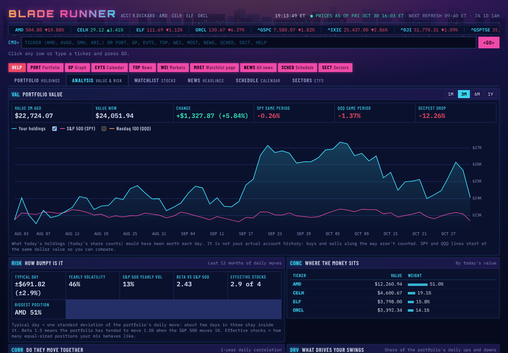

# poopfartporker

A tiny AI agent for learning: a notes assistant built on the Claude API.

## Run it

```bash
pip install -r requirements.txt
```

```bash
export ANTHROPIC_API_KEY=sk-ant-...
```

```bash
python agent.py
```

Try: `save a note called groceries: eggs, milk`, then `what's in my groceries note?`, then `what is 17% of 240?`.

## How it works (read `agent.py` top to bottom)

1. **Tools**: ordinary Python functions (calculator, clock, read/write/list notes).
2. **Tool descriptions**: a name, a description and a JSON schema for each tool. Claude reads these to decide what to call. Claude never runs your code itself; it asks you to run it.
3. **The loop** (`agent_turn`): send messages and tools to Claude. If `stop_reason == "tool_use"`, run the tools and send the results back. Repeat until Claude replies with plain text.
4. **Memory**: the `messages` list. Everything said and every tool result stays there, so the agent remembers earlier turns.

## Ideas to try next

- Add a tool, for example `delete_note` or `search_notes`. Write the function, add a schema, and register it in `TOOL_FUNCTIONS`.
- Change `SYSTEM_PROMPT` and see how the agent's behaviour changes.
- Ask the agent to confirm before it overwrites a note.
- Run the offline tests with `python -m pytest test_agent.py`.

## Blade Runner (terminal)



`blade-runner-terminal.html` is a Bloomberg-style dashboard for the Blade Runner portfolio (AMD, CELH, ELF, ORCL) and its watchlist. It has six pages (tabs, or `#terminal`, `#analysis`, `#watchlist`, `#news`, `#schedule`, `#sectors` in the URL):

- **Portfolio**: holdings with a card per stock (next earnings, its sector fund today, how it did against that fund last month, analyst target), price chart, holdings news, upcoming dates, markets. For five days after a holding reports, an earnings recap card shows the price reaction and the headlines since. **Edit holdings** changes share counts, average cost and which stocks you hold (any tracked stock); edits are saved in that browser only.
- **Analysis**: what today's holdings would have been worth over 1M to 1Y against SPY and QQQ, plus risk: typical daily move, volatility, beta, concentration, a correlation grid and each stock's share of the portfolio's swings.
- **Watchlist**: the 88-stock watchlist with the same price chart. Every stock (holdings and watchlist) shows a Street rating (analyst Buy/Hold/Sell consensus) and a Trend signal (price vs its 50- and 200-day averages).
- **News**: headlines for the holdings and for each sector (semis, software, biotech, regional banks, homebuilders, market), filterable, with a sector check on the side.
- **Schedule**: earnings, Fed and macro dates, grouped by week.
- **Sectors**: how each sector is doing, through 25 ETFs including yours (QQQ, SMH, SOXX, IGV, XBI, KRE, XHB, ITB): a heat map, a relative chart, stock-vs-sector, spreads and a scoreboard of 25 ETFs.

Files:

- `terminal/portfolio.json`: share counts, watchlist groups, market instruments, ETFs (with descriptions), spread pairs and news feeds.
- `terminal/events.json`: upcoming earnings and macro dates shown on the Schedule page.
- `terminal/alerts.py`: run after `build.py`; prints phone alerts (a holding moving 5%+ in a day, earnings within 3 days, an analyst consensus change) and keeps what it already sent in a small `tm-state` block at the top of the page.
- `terminal/build.py`: pulls prices, charts and headlines from Yahoo Finance, plus valuation ratios and analyst ratings from Nasdaq, for every stock (holdings and watchlist get the same set) and ETF, and bakes them into the page. Standard library only. To add a stock, put its ticker in a `watchlist` group in `portfolio.json`; to add an ETF, add a row to `etfs`.

Refresh by hand:

```
python3 terminal/build.py
```

Scheduled tasks run it, then `alerts.py`, every weekday hour from 9:35 AM to 3:35 PM ET plus 4:10 PM (just after the close), push any alerts to your phone and republish the artifact. It does not commit, so the data baked into the copy here is whatever was last committed by hand.
